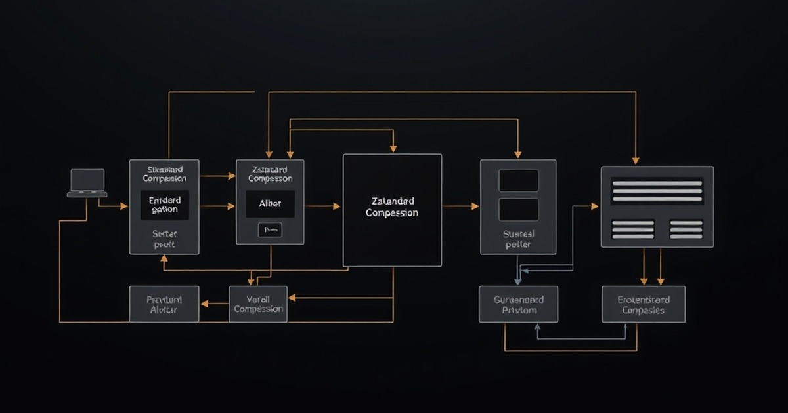

# Fast Vault Bridge

[](https://github.com/Amz34/fast-vault-bridge/actions/workflows/ci.yml)
[](LICENSE)
[](https://www.python.org/)

High-performance, crash-proof Zstandard multi-core streaming archiver and verification daemon designed for offloading high-capacity workspaces to external network-attached storage or cloud vaults with zero data degradation.



---

## Overview

Modern software development workspaces accumulate dozens of gigabytes across build caches, model weights, container images, and dependency trees. Synchronizing these large directory trees file-by-file across network remotes suffers from high I/O latency and network overhead.

`fast-vault-bridge` transforms workspace trees into multi-threaded, densely compressed Zstandard archive streams in real-time. It validates cryptographic SHA-256 digests on the fly, copies the stream directly to target storage (via `rclone` remotes or local filesystem mounts), and purges temporary buffer caches atomically upon verified upload.

```
+---------------------+     +--------------------+     +------------------------+
| Workspace Directory | --> | Exclusion Filter   | --> | Multi-Core Zstandard   |
| (Source Tree)       |     | (.venv, node_mods) |     | Streaming Compression  |
+---------------------+     +--------------------+     +------------------------+
                                                                   |
                                                                   v
+---------------------+     +--------------------+     +------------------------+
| Atomic Cache Purge  | <-- | Remote Destination | <-- | SHA-256 Cryptographic  |
| (On Success)        |     | (rclone / local)   |     | Integrity Verification |
+---------------------+     +--------------------+     +------------------------+
```

---

## Features

- **Multi-Core Zstandard Compression:** Leverages multi-threaded streaming (`zstd -T4` or configured CPU core count) to achieve high compression throughput without saturating host memory.
- **Cryptographic Verification:** Computes chunked SHA-256 checksums and validates archive internal structures before committing transfers.
- **Fault-Tolerant Queue Daemon:** Processes batch offload manifests with isolated error handling; missing paths or transfer failures on individual targets never disrupt the entire queue.
- **Zero External Python Dependencies:** Core engine uses Python standard library modules with system utility fallbacks (`tarfile` / `shutil`), requiring no third-party package installations.
- **Flexible Destination Routing:** Streams payloads directly into local mount paths, external storage drives, or `rclone`-configured cloud storage remotes.
- **Automated Staging Buffer Cleanup:** Automatically purges temporary archive payloads immediately upon successful transfer verification, preserving local disk space.

---

## Installation

Clone the repository and verify the test suite:

```bash
git clone https://github.com/Amz34/fast-vault-bridge.git
cd fast-vault-bridge
make test
```

No external Python dependencies are required. For maximum compression throughput, ensure `zstd`, `tar`, and `rclone` are available on your system path.

---

## Quick Start

### 1. Stream a Single Directory

Archive and stream a project directory to the destination vault:

```bash
python3 -m fast_vault.cli stream \
    --src ~/projects/my-workspace \
    --name my_workspace \
    --category projects_archive \
    --dest "/mnt/backup_vault"
```

To dry-run and inspect planned actions without writing data:

```bash
python3 -m fast_vault.cli stream \
    --src ~/projects/my-workspace \
    --name my_workspace \
    --dry-run
```

### 2. Execute a Batch Backup Queue

Create a JSON manifest describing targets and categories:

```json
[
  {
    "name": "primary_codebase",
    "src": "~/projects/core-engine",
    "category": "code_archives"
  },
  {
    "name": "model_artifacts",
    "src": "~/models/weights",
    "category": "models_archive"
  }
]
```

Run the queue runner:

```bash
python3 -m fast_vault.cli run-queue --config queue.example.json --dest "vault_remote:backup"
```

### 3. Verify Archive Integrity

Verify that an existing archive matches its calculated or expected checksum:

```bash
python3 -m fast_vault.cli verify \
    --archive /tmp/vault_pack/primary_codebase.tar.zst \
    --sha256 "e3b0c44298fc1c149afbf4c8996fb92427ae41e4649b934ca495991b7852b855"
```

---

## Configuration

The engine reads defaults from standard environment variables:

| Variable | Default | Description |
|---|---|---|
| `VAULT_DEST_BASE` | `/tmp/vault_dest` | Base storage target (local directory or rclone remote) |
| `VAULT_BUFFER_DIR` | `/tmp/vault_pack` | Temporary staging directory for active compression streams |
| `VAULT_CONFIG` | `queue.json` | Default queue manifest path for batch runners |
| `VAULT_LOG_FILE` | `/tmp/fast_vault_engine.log` | Destination path for daemon execution logs |

---

## Ecosystem Integration

Part of the [Amz34](https://github.com/Amz34) autonomous infrastructure toolchain.

Explore curated agent and infrastructure utilities in [Awesome Agent Infrastructure](https://github.com/Amz34/awesome-agent-infrastructure).


---

## License

This project is licensed under the MIT License — see the [LICENSE](LICENSE) file for details.
